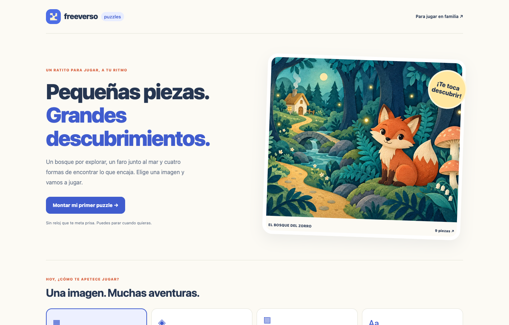

<p align="center"><strong>Freeverso Puzzles</strong><br>Pequeñas piezas. Grandes descubrimientos.</p>

# Freeverso Puzzles

Cuatro juegos de navegador con ilustraciones de ejemplo: intercambiar piezas, parejas, deslizar y descubrir palabras.

[](LICENSE) [](https://github.com/davidcantonnadales/freeverso-puzzles-starter/actions/workflows/checks.yml)



## Qué puedes hacer

- Cuatro imágenes originales; 16 combinaciones de imagen y modo.
- Puzzles de 3 × 3, arrastre o selección de dos piezas.
- Tableros deslizantes generados mediante movimientos legales: siempre resolubles.
- Seis parejas y palabras en español, sin vidas ni cuenta atrás.
- Pausa, reinicio con confirmación y mensaje al completar.
- Sin cuentas, anuncios, datos personales, servicios de IA ni clasificación de menores.

## Arrancar en tu equipo

Recomendado: **Node.js 22.13 o posterior de la rama 22**, con npm. `.nvmrc` selecciona Node 22. Las pruebas iniciales locales se ejecutaron con Node 23.10.0; CI utiliza Node 22. Las aplicaciones con SQLite usan `node:sqlite`, que puede mostrar un aviso experimental según la versión.

```bash
npm ci
npm run dev
```

Abre **http://127.0.0.1:3000**. Para comprobar una compilación de producción:

```bash
npm test
npm run build
npm start
```

## Una prueba de cinco minutos

Elige una ilustración y un modo. En Piezas, toca dos casillas para intercambiarlas; también funcionan Tab y Espacio. En Deslizar solo se mueve una pieza junto al hueco. Prueba Pausa y Empezar de nuevo.

## Qué incluye esta edición

Las partidas no se guardan al recargar o cerrar. Parejas utiliza seis símbolos; las otras modalidades usan las ilustraciones. No se han hecho estudios educativos ni pruebas con familias, y no se atribuyen beneficios terapéuticos. Las pruebas móviles se realizaron en Chrome con viewport reducido, no en un teléfono físico.

Esta es una edición pública independiente y adaptada para aprender y desarrollar sobre ella. No incluye datos, credenciales, dominios privados ni infraestructura de la instalación de origen. No pretende reproducir todos los módulos de esa instalación.

## Documentación y pruebas

- [Cómo está organizado y cómo configurarlo](docs/CONFIGURACION.md).
- [Pruebas realizadas y límites](docs/PRUEBAS.md).
- [Procedencia de imágenes y capturas](docs/IMAGENES.md).
- [Seguridad y datos](SECURITY.md).


## Contribuir

Abre una issue con los pasos para reproducir el problema, el resultado esperado y la versión de Node/navegador. Para proponer un cambio, crea una rama, comprueba `npm test` y `npm run build`, y abre una pull request. No adjuntes datos personales, documentos de clientes, claves o archivos `.env`.

## Licencia

Código y documentación bajo [MIT](LICENSE). Las ilustraciones de ejemplo, cuando las hay, se generaron con IA para este proyecto y se distribuyen bajo los mismos términos en la medida en que existan derechos aplicables; no se garantiza exclusividad. Las dependencias conservan sus licencias. No se incluyen marcas ni recursos de terceros para sugerir patrocinio.

Creado por [David Cantón](https://davidcanton.net).
